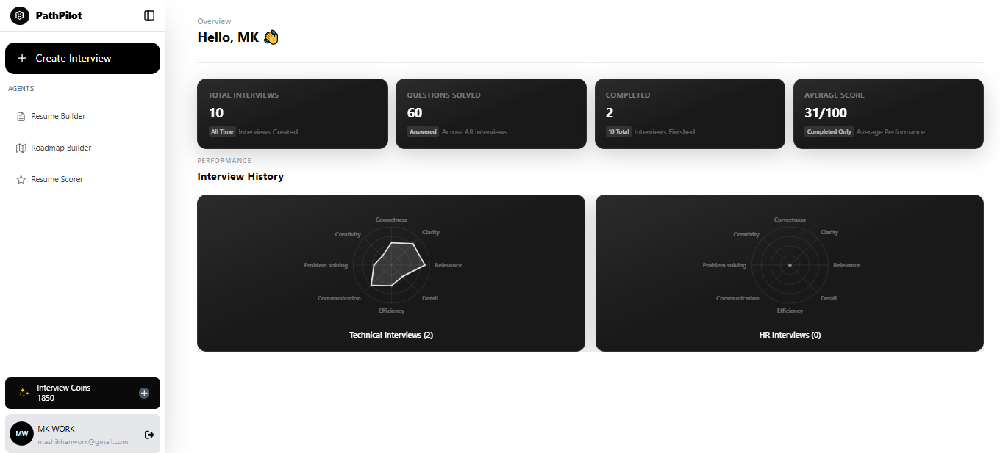
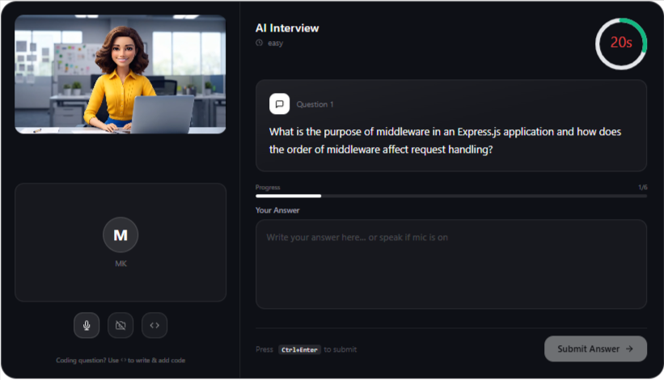
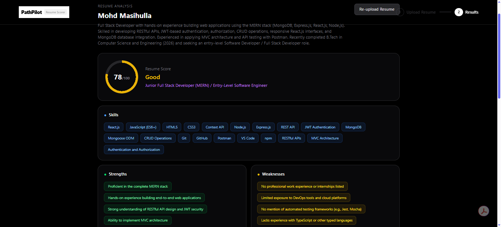
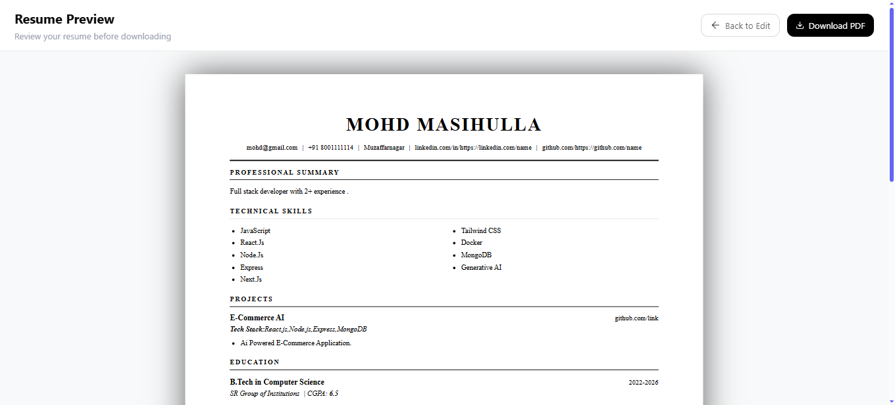
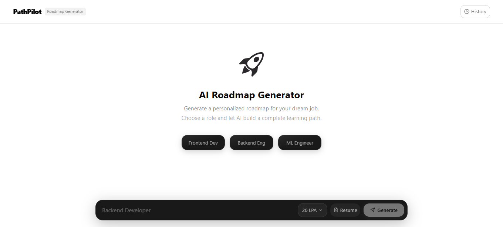
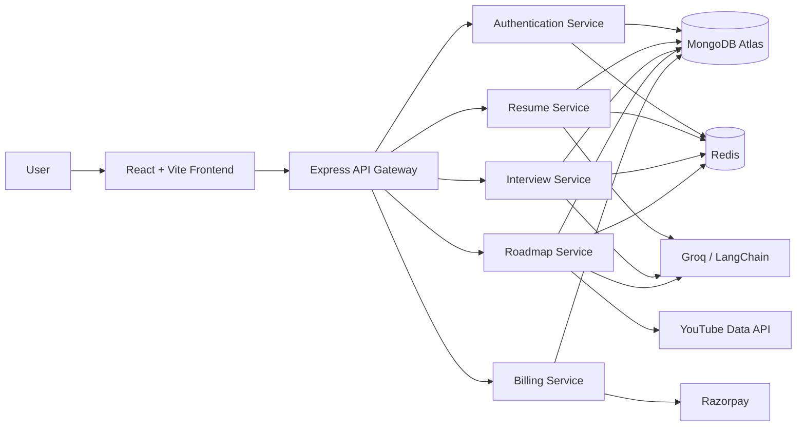

# PathPilot

AI-powered career preparation, in one place.

PathPilot helps job seekers prepare for their next career move with AI-assisted resume feedback, resume building, mock interviews, and personalized learning roadmaps. It combines a React application with a gateway and independently deployable backend services.

**Live Application:** [PathPilot](https://pathpilot-jet.vercel.app)

## Table of Contents

- [What You Can Do](#what-you-can-do)
- [Screenshots](#screenshots)
- [How It Works](#how-it-works)
- [Technology Stack](#technology-stack)
- [Getting Started](#getting-started)
- [Environment Configuration](#environment-configuration)
- [Service Map](#service-map)
- [Deployment](#deployment)
- [Security](#security)
- [Contributing](#contributing)
- [License](#license)

## What You Can Do

- **Resume Analysis:** Upload a PDF resume and receive AI-generated insights, a resume score, and recommendations for improvement.
- **Resume Builder:** Create and refine resume content using the resume builder.
- **AI Mock Interviews:** Practice interviews for a selected role, answer AI-generated questions, and review feedback and reports.
- **Personalized Career Roadmaps:** Generate role-specific learning plans, optionally using your resume, along with relevant learning resources.
- **User Authentication:** Sign in with Google and access your personal dashboard and saved work.
- **Interview Credits:** Purchase interview credits through Razorpay checkout.

## Screenshots

### Dashboard


### Mock Interview


### Resume Analysis


### Resume Builder


### Career Roadmap


## How It Works

The frontend sends API requests to the backend gateway. The gateway handles authentication and routes requests to the appropriate microservice.



## Technology Stack

| Category | Technologies |
| --- | --- |
| Frontend | React, Vite, React Router, Redux Toolkit, Tailwind CSS |
| Backend | Node.js, Express.js |
| Microservices and Containerization | Docker, Docker Compose |
| AI Workflows | Groq, LangChain, LangGraph |
| Database | MongoDB |
| Caching | Redis |
| Authentication | Firebase Authentication, Firebase Admin |
| Payments | Razorpay |
| Learning Resources | YouTube Data API |

## Getting Started

### Prerequisites

Make sure you have the following installed or configured:

- [Git](https://git-scm.com/)
- [Node.js](https://nodejs.org/) version 22 or later, with npm
- [Docker Desktop](https://www.docker.com/products/docker-desktop/) with Docker Compose
- Access to MongoDB and Redis
- API keys and credentials for the third-party services you plan to use

### 1. Clone the Repository

```bash
git clone https://github.com/Mashikhaan/pathpilot.git
cd pathpilot
```

### 2. Configure the Frontend

Create a `.env` file inside the `frontend` directory.

```env
VITE_BACKEND_URL=http://localhost:8000
VITE_RAZORPAY_KEY_ID=your_razorpay_key_id
VITE_FIREBASE_API_KEY=your_firebase_web_api_key
```

`VITE_BACKEND_URL` should point to the backend gateway's base URL. The Razorpay key ID is used to initialize checkout, while the corresponding secret must remain on the server.

### 3. Configure Backend Services

Create a `.env` file for each backend service using its corresponding example file.

| Service | Example Environment File |
| --- | --- |
| Authentication | `backend/services/auth/.env.example` |
| Resume | `backend/services/resume/.env.example` |
| Interview | `backend/services/interview/.env.example` |
| Roadmap | `backend/services/roadmap/.env.example` |
| Billing | `backend/services/billing/.env.example` |

Configure the environment variables required by the services you intend to run.

Docker Compose also expects the following files to exist:

- `backend/gateway/.env`
- `frontend/.env`

Use the following ports in the respective backend environment files, matching the Docker Compose configuration.

| Environment File | Port |
| --- | ---: |
| `backend/gateway/.env` | `8000` |
| `backend/services/auth/.env` | `8001` |
| `backend/services/resume/.env` | `8002` |
| `backend/services/interview/.env` | `8003` |
| `backend/services/roadmap/.env` | `8004` |
| `backend/services/billing/.env` | `8005` |

The authentication service also requires Firebase Admin credentials. Configure the service to load its service-account credentials securely. Do not commit service-account JSON files or private keys.

### 4. Start the Application

From the project root, navigate to the `backend` directory and start the services with Docker Compose.

```bash
cd backend
docker compose up --build
```

Once the containers are running, access the application at:

- **Frontend:** [http://localhost:5173](http://localhost:5173)
- **API Gateway:** [http://localhost:8000](http://localhost:8000)

The frontend container runs Vite in development mode.

To stop the running containers, press `Ctrl+C`. To remove the stopped containers, run the following command from the `backend` directory:

```bash
docker compose down
```

### Running the Frontend Without Docker

You can also run the frontend separately, provided the backend is running and reachable through `VITE_BACKEND_URL`.

```bash
cd frontend
npm install
npm run dev
```

Other useful frontend commands:

```bash
npm run build
npm run lint
npm run preview
```

## Environment Configuration

The `.env.example` files document the environment variables used by individual services. The following table summarizes the main configuration variables.

| Variable | Used By | Purpose |
| --- | --- | --- |
| `VITE_BACKEND_URL` | Frontend | Base URL of the API gateway |
| `VITE_RAZORPAY_KEY_ID` | Frontend | Public Razorpay key ID for checkout |
| `VITE_FIREBASE_API_KEY` | Frontend | Firebase web application configuration |
| `PORT` | Backend services | Port on which a service listens |
| `MONGODB_URL` | Auth, Resume, Interview, Roadmap, Billing | MongoDB connection string |
| `REDIS_URL` | Auth, Resume, Interview, Roadmap | Redis connection string |
| `GROQ_API_KEY` | Resume, Interview, Roadmap | API key for AI features |
| `YOUTUBE_API_KEY` | Roadmap | Access to the YouTube Data API |
| `RAZORPAY_KEY_ID` | Billing | Server-side Razorpay key ID |
| `RAZORPAY_KEY_SECRET` | Billing | Payment verification secret |
| `INTERNAL_SERVICE_SECRET` | Auth, Billing | Shared secret for trusted service-to-service requests |
| `FRONTEND_URL` | Gateway | Allowed frontend origin for CORS |
| `AUTH_SERVICE_URL` | Billing, Gateway | URL of the authentication service |
| `RESUME_SERVICE_URL` | Gateway | URL of the resume service |
| `INTERVIEW_SERVICE_URL` | Gateway | URL of the interview service |
| `ROADMAP_SERVICE_URL` | Gateway | URL of the roadmap service |
| `BILLING_SERVICE_URL` | Gateway | URL of the billing service |

When using Docker Compose, configure the internal service URLs using the appropriate Compose service names. For separately deployed services, use their reachable deployment URLs.

Keep all credentials and secrets in local, untracked environment files or your deployment platform's secret manager.

## Service Map

| Component | Local Port | Responsibility |
| --- | ---: | --- |
| Frontend | `5173` | User interface and feature workflows |
| API Gateway | `8000` | API entry point, authentication middleware, and request routing |
| Authentication Service | `8001` | Google sign-in, sessions, user profiles, and interview credits |
| Resume Service | `8002` | PDF resume analysis and saved resume results |
| Interview Service | `8003` | Interview sessions, answers, feedback, and reports |
| Roadmap Service | `8004` | Personalized career roadmaps and learning resources |
| Billing Service | `8005` | Razorpay order creation and payment verification |
| Redis | `6379` | Session and feature-data caching |

Backend services communicate through Docker Compose's internal network. The API gateway acts as the main backend entry point exposed to the host.

## Deployment

The frontend is deployed on Vercel:

[PathPilot Live Application](https://pathpilot-jet.vercel.app)

For a production deployment:

1. Deploy the API gateway and backend microservices, ensuring the gateway can reach each service through its configured URL.
2. Configure MongoDB and Redis connection strings that are accessible from the deployed backend services.
3. Set the correct production frontend origin in the gateway's CORS configuration.
4. Add API keys and other credentials through the deployment platform's secret manager.
5. Configure Firebase authorized domains and Razorpay settings for the production domain and payment mode.
6. Set the frontend's `VITE_BACKEND_URL` to the public URL of the deployed gateway.
7. Build the frontend using `npm run build` and deploy the generated `dist/` directory through your frontend hosting provider.

The Docker Compose frontend configuration is intended for local development. Production frontend builds and hosting should be configured separately.

## Security

- Never commit `.env` files, API keys, payment secrets, Firebase service-account credentials, or private keys.
- Keep `VITE_` environment variables limited to values intended to be exposed in the browser.
- Never expose server-side secrets through frontend environment variables.
- Use HTTPS and production credentials when deploying.
- If any credentials are exposed, rotate them and remove them from the repository before publishing or sharing the project.

## Contributing

Contributions are welcome.

For substantial changes, open an issue first to discuss the proposed approach. When submitting a pull request, include a concise summary of the changes and the checks you ran, such as `npm run lint` and `npm run build` inside the `frontend` directory.

## License

No license is currently specified for this repository. Contact the project maintainers before reusing or redistributing the code.
